# NEXUS Smart Factory

Predictive-maintenance analytics on the UCI AI4I 2020 dataset: a trained failure-risk model turns sensor telemetry into a **ranked maintenance work queue**, served through a Flask plant dashboard, with a separate NASA C-MAPSS remaining-useful-life (RUL) regression study. Built for maintenance and reliability teams (and the engineers reviewing this portfolio project) who need to decide which assets to inspect first.


## Key results

- **AI4I failure classifier (HistGradientBoosting):** PR-AUC **0.9019**, ROC-AUC **0.9874** on the seed-42 80/20 holdout; five-split robustness mean PR-AUC 0.880 ± 0.032 ([details](#final-model-performance)).
- **Review queue:** reviewing the **top 10% of assets** (200 machines) captures **94.1% of all holdout failures** ([details](#maintenance-review-queue)).
- **NASA C-MAPSS FD001 RUL regression:** RMSE **18.05** cycles vs 49.82 for the naive median baseline (**63.8% RMSE reduction**) on NASA's official test protocol ([details](#rul-regression-nasa-c-mapss)).

## Live demo

**Predictive-maintenance analytics case study** — end-to-end ML pipeline on the UCI AI4I 2020 dataset, including EDA, feature engineering, model selection, SQL analysis, review-queue design, and cost framing. Packaged with a Flask plant dashboard, plus a [second case study](#rul-regression-nasa-c-mapss) demonstrating genuine remaining-useful-life (RUL) regression on NASA's C-MAPSS run-to-failure dataset.

Demo: **[smart-factory-app.onrender.com](https://smart-factory-app.onrender.com)** (live app) · [Portfolio project entry](https://senanur-cetin.vercel.app/projects/smart-factory-app)

First load may take ~1 minute on the free Render tier while the service wakes up.

**Live report sources:** [Industrial Analytics Dashboard](https://smart-factory-app.onrender.com/) · [Scored telemetry CSV](https://smart-factory-app.onrender.com/api/report.csv) · [AI4I model evaluation](https://smart-factory-app.onrender.com/case-study) · [True RUL regression study](https://smart-factory-app.onrender.com/rul-case-study).

The application includes **three synchronized, functioning time-series panels** for process temperature, tool wear and the trained classifier's risk score, plus an **OEE decomposition** showing Availability × Performance × Quality. The CSV export contains the Flask worker's **latest 240 shared simulated sensor readings scored by the trained model** (a rolling buffer), including an explicitly labelled *heuristic* RUL proxy. The export does **not** invent plant readings, company data or calibrated survival estimates. Data is created as visitors poll the shared demo endpoint. The CSV is **not isolated per visitor**; different worker processes can show different rolling buffers. A worker with no readings returns a header-only export.

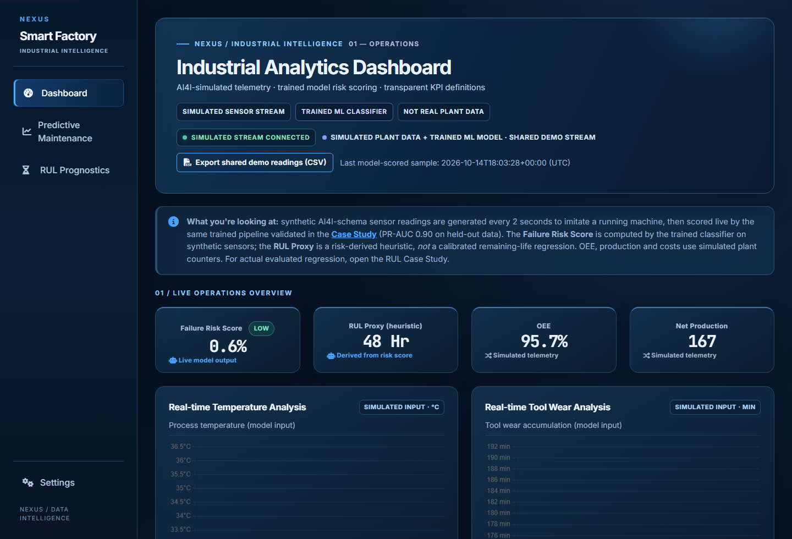

*Historical 14 October 2026 capture; dashboard sensor/OEE data is simulated. See [Limitations](#limitations) for screenshot provenance.*

## Quick start

```bash
python -m venv .venv
# Windows:  .venv\Scripts\activate
# macOS/Linux:  source .venv/bin/activate
pip install -r requirements-dev.txt
python main.py   # http://127.0.0.1:8080

# or with Docker
docker build -t smart-factory-app .
docker run -p 8080:8080 smart-factory-app
```

Full setup (charts, SQL analysis, retraining, RUL study): [Local Setup](#local-setup) · [Docker](#docker) · [Tests](#tests).

---

## Contents

[Dashboard and API](#dashboard-and-api) · [Problem](#problem) · [Dataset](#dataset) · [EDA](#exploratory-data-analysis) · [Feature engineering](#feature-engineering) · [Model selection](#model-selection) · [Final model performance](#final-model-performance) · [Validation robustness](#validation-robustness) · [SQL analysis](#sql-analysis) · [Review queue](#maintenance-review-queue) · [Cost impact](#cost-impact) · [RUL regression](#rul-regression-nasa-c-mapss) · [Engineering decisions](#engineering-decisions) · [Architecture](#architecture) · [Local setup](#local-setup) · [Docker](#docker) · [Tests](#tests) · [Documentation](#documentation) · [Limitations](#limitations)

## Dashboard and API

| Surface | Source | Meaning |
| --- | --- | --- |
| Temperature and wear charts | Latest API-generated AI4I-schema readings | Simulated telemetry |
| Failure risk trend | Trained HistGradientBoosting `predict_proba` on current simulated inputs | Real model output, not a calibrated failure probability |
| OEE breakdown | `availability * performance * quality` from process-global simulated downtime/production/scrap | Real formula on simulated counters |
| RUL number | Monotonic risk-derived proxy | Heuristic; separate from the NASA C-MAPSS RUL model |
| [Downloadable CSV](https://smart-factory-app.onrender.com/api/report.csv) | `/api/report.csv`, last 240 simulated readings | Shared-worker window with ISO 8601 UTC timestamps and a provenance header |

On-screen trends use a short server-local time-of-day label; the newest reading also shows a full UTC timestamp, which the CSV exports for sorting and cross-day analysis.

[`GET /api/benchmark-snapshot`](https://smart-factory-app.onrender.com/api/benchmark-snapshot) returns the committed AI4I/FD001 model cards and evaluation JSON with model/data lineage fingerprints and `data_origin=committed_offline_case_studies`, `bigquery_dataset_connected=false` flags. Missing or incomplete inputs return HTTP 503.

**Routes** (deployed from the committed `render.yaml` blueprint, Docker runtime on Render's free tier): [dashboard `/`](https://smart-factory-app.onrender.com/) · [AI4I case study `/case-study`](https://smart-factory-app.onrender.com/case-study) · [RUL case study `/rul-case-study`](https://smart-factory-app.onrender.com/rul-case-study) · [settings and model card `/settings`](https://smart-factory-app.onrender.com/settings). Hugging Face: [ONNX model card](https://huggingface.co/senanurcetin/ai4i-failure-hgb) and an [in-browser failure-risk demo](https://huggingface.co/spaces/senanurcetin/ai4i-failure-risk) (sliders, no server).

All routes, including both Decision Studio pages, share the NEXUS navigation layout ([brand assets](docs/NEXUS_BRAND_INTEGRATION.md)); the sidebar collapses to an off-canvas menu below 900px. Accessibility basics: skip-to-content link, `aria-label`s and keyboard-operable controls.

**Why Render rather than Vercel:** Vercel's serverless Python functions have a ~250 MB unzipped size limit that this dependency stack is likely to exceed. Render (like Fly.io or Cloud Run) runs the existing Dockerfile as a container, so there is one build path for CI and production.

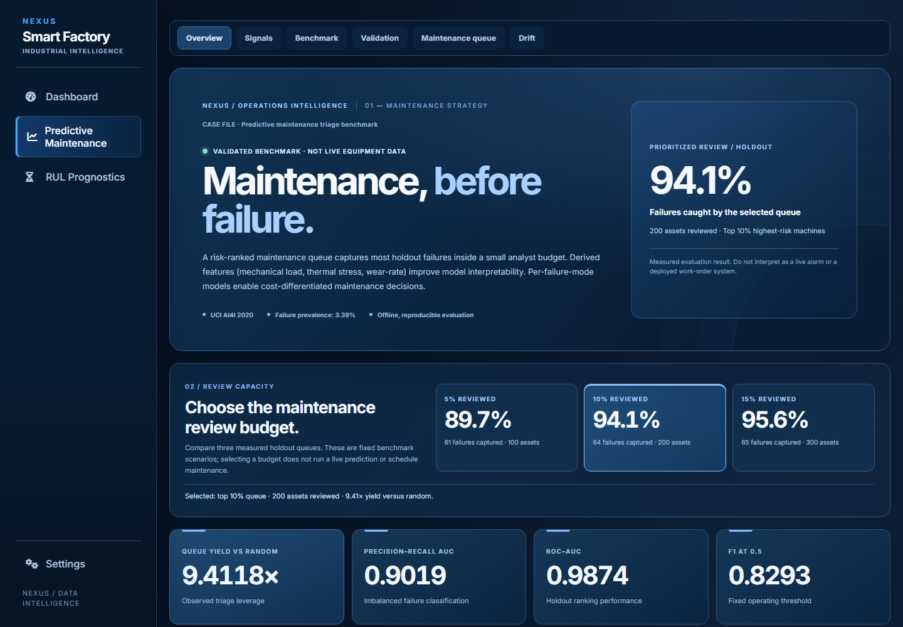

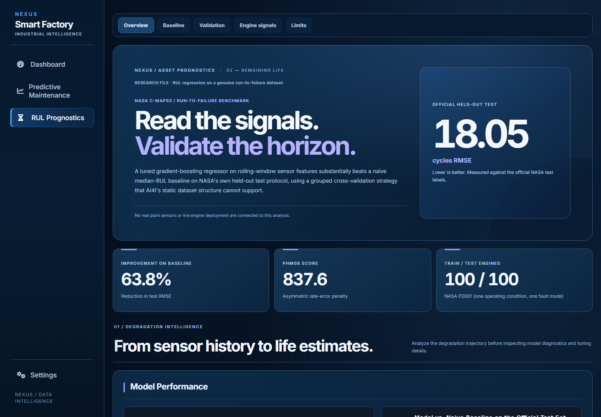

[375px mobile screenshot](docs/assets/smart-factory-mobile-375.png) · [Short dashboard video](docs/assets/smart-factory-dashboard.webm)

## Problem

Maintenance teams cannot review every asset equally. The question is whether sensor telemetry can be translated into a **ranked work queue** that captures most failures within a limited review budget, and whether that logic can be expressed in terms of cost.

## Dataset

| Property | Value |
|----------|-------|
| Source | [UCI AI4I 2020 Predictive Maintenance Dataset](https://archive.ics.uci.edu/dataset/601/ai4i+2020+predictive+maintenance+dataset) |
| Records | 10,000 |
| Failure rate | 3.39% — 339 failures across 9,661 normal records |
| Evaluation | Deterministic 80/20 stratified holdout (seed=42) |
| Raw features | Product type, air temp, process temp, rotational speed, torque, tool wear |

## Exploratory Data Analysis

**Class imbalance.** At a 3.39% failure rate, accuracy is misleading; PR-AUC and recall are the evaluation signals used throughout.

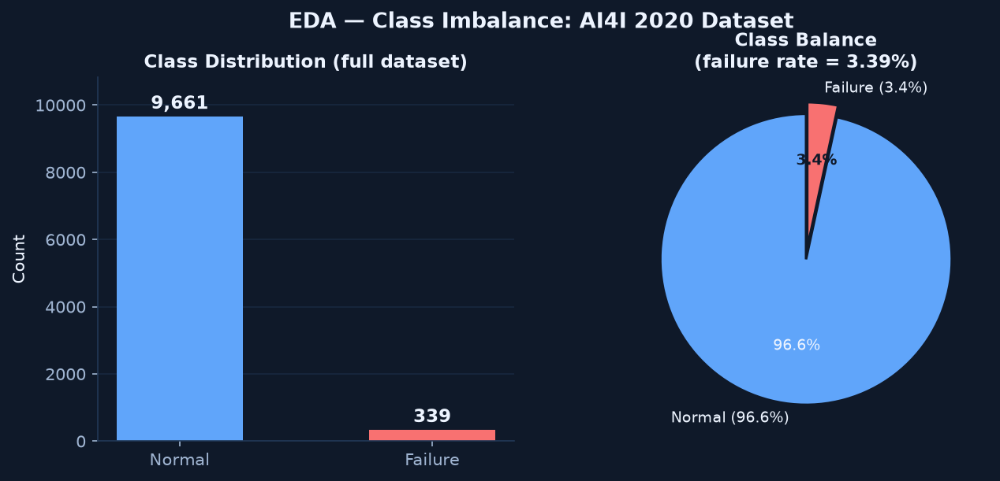

**Failure modes.** Heat dissipation (HDF) and overstrain (OSF) are the most frequent failure types. Random failures (RNF) are rare and poorly separable.

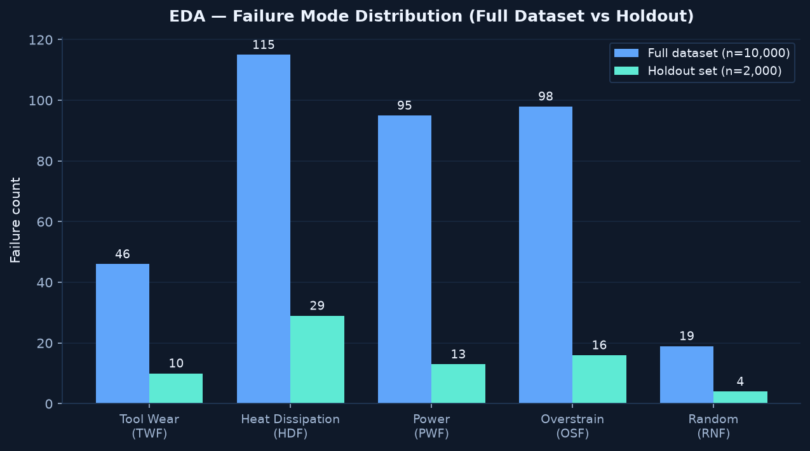

**Product type.** Type L (low quality) makes up 60% of records; Type H (high quality) is the smallest slice at 10%.

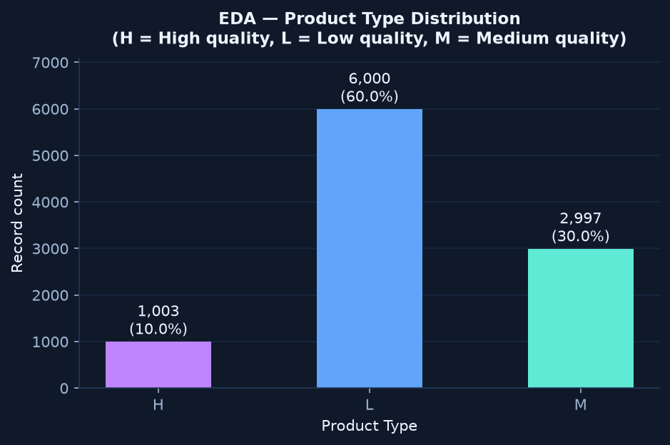

## Feature Engineering

Three cross-sensor features capture interaction effects that individual raw sensors cannot express:

| Derived feature | Formula | Intuition |
|-----------------|---------|-----------|
| `mechanical_load` | Torque x RPM | Proxy for power delivered to the spindle |
| `thermal_stress` | (Process temp - Air temp) / Air temp | Relative thermal load under operating conditions |
| `tool_wear_load_ratio` | Tool wear / Torque | Wear rate per unit of mechanical load |

Isolated impact (same tuned hyperparameters, raw vs. enhanced features, so the delta is attributable to the derived features alone): ROC-AUC **+0.018**, PR-AUC **+0.077**, F1 **+0.082**.

## Model Selection

Four models benchmarked on the holdout using the **raw feature set** and default hyperparameters:

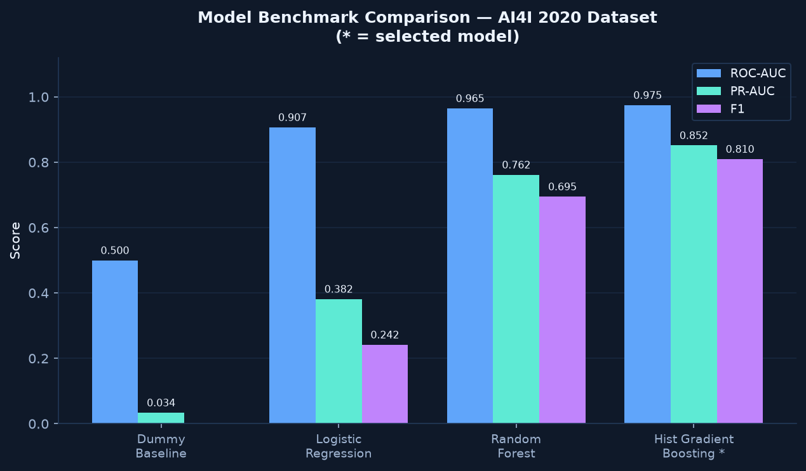

| Model | ROC-AUC | PR-AUC | F1 |
|-------|---------|--------|----|
| Dummy baseline | 0.500 | 0.034 | 0.000 |
| Logistic regression | 0.907 | 0.382 | 0.242 |
| Random forest | 0.965 | 0.762 | 0.695 |
| **HistGradientBoosting** (selected) | **0.975** | **0.852** | **0.810** |

HistGradientBoosting has the highest PR-AUC and F1. The deployed model adds the derived features above and a tuned hyperparameter search.

**Feature importance.** Permutation importance (average-precision scoring, 8 repeats) on the final model: rotational speed and `thermal_stress` dominate, and the derived features rank in the top 5.

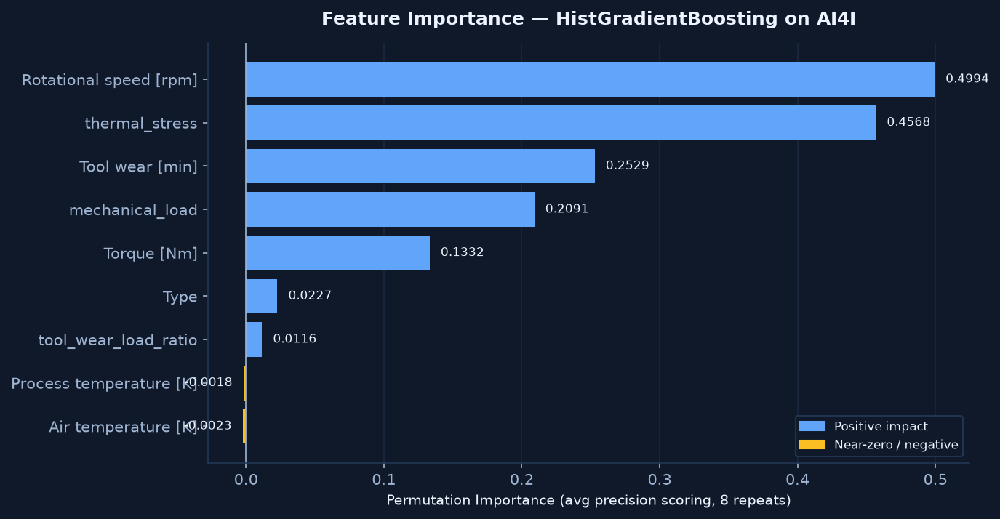

## Final Model Performance

HistGradientBoosting with derived features and tuned hyperparameters (`max_leaf_nodes=15`, `learning_rate=0.03`, `l2_regularization=1.0`, unrestricted `max_depth`):

| Metric | Value |
|--------|-------|
| ROC-AUC | **0.9874** |
| PR-AUC | **0.9019** |
| Precision | **0.9273** |
| Recall | **0.75** |
| F1 | **0.8293** |
| Sample-weighted ECE (10 quantile cutpoints) | 0.006080 on the 2,000-row test split |
| Legacy unweighted mean bin gap | 0.007046 (previously rounded to 0.007; not weighted ECE) |
| Brier score (recomputed from saved model) | 0.008444 on the same holdout |

Reloading the committed model and scoring the original seed-42 holdout reproduces ROC-AUC 0.987429, PR-AUC 0.901899 and the archived confusion matrix ([SHA-256-pinned audit with occupied-bin counts](docs/data/ai4i-case-study/calibration-reassessment-20261102.json) · [replay script](analysis/audit_ai4i_calibration.py)).

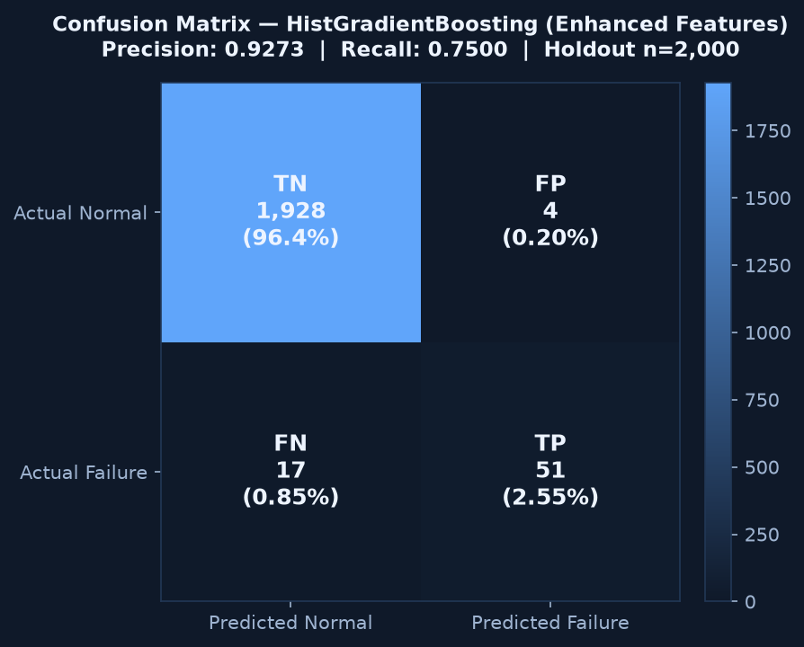

Of 68 actual failures in the holdout: **51 flagged (TP)**, 17 missed (FN), 4 false alarms (FP). Tuning traded some recall for precision relative to the untuned model, because the search optimised threshold-independent PR-AUC rather than F1.

**Hyperparameter tuning.** `RandomizedSearchCV` (20 iterations, 5-fold stratified CV, PR-AUC scoring) over `max_depth`, `learning_rate`, `l2_regularization` and `max_leaf_nodes`. Config and results: [`model-selection.json`](docs/data/ai4i-case-study/model-selection.json).

**Explainability.** Local attribution for the 10 highest-risk holdout predictions uses `shap.TreeExplainer` (interventional, probability space), which accounts for feature interactions such as torque and tool wear jointly driving overstrain risk. Output: [`feature-importance.json`](docs/data/ai4i-case-study/feature-importance.json) → `local_attributions_top10_high_risk`.

## Validation Robustness

AI4I 2020 has no time axis or repeated-asset grouping (each row is an independently sampled machine snapshot with a unique Product ID), so time-aware or `GroupKFold` splitting does not apply. The final architecture was instead re-fit across 5 independent stratified 80/20 splits:

**ROC-AUC 0.984 ± 0.004, PR-AUC 0.880 ± 0.032.** PR-AUC varies more because only ~68 failures land in each holdout; the single-split 0.90 sits at the high end of the range. Per-seed results: [`validation-robustness.json`](docs/data/ai4i-case-study/validation-robustness.json).

## SQL Analysis

**DuckDB** queries run directly on the JSON artifacts; results in [`sql-analysis.json`](docs/data/ai4i-case-study/sql-analysis.json).

**Q1 — Failure modes by frequency and capture rate:**

| Code | Label | Holdout failures | Capture rate at top 10% |
|------|-------|-----------------|------------------------|
| HDF | Heat dissipation | 29 | 100% |
| OSF | Overstrain | 16 | 100% |
| PWF | Power failure | 13 | 100% |
| TWF | Tool wear | 10 | 70% |
| RNF | Random | 4 | 25% |

**Q2 — Models by PR-AUC:** HistGradientBoosting 0.852 > RandomForest 0.762 > LogisticRegression 0.382 > Dummy 0.034

**Q3 — Review queue ROI:**

| Budget | Failures caught | Yield lift | Assets per failure caught |
|--------|----------------|-----------|--------------------------|
| 5% — 100 assets | 89.7% | 17.9x | 1.6 |
| 10% — 200 assets | 94.1% | 9.4x | 3.1 |
| 15% — 300 assets | 95.6% | 6.4x | 4.6 |

## Maintenance Review Queue

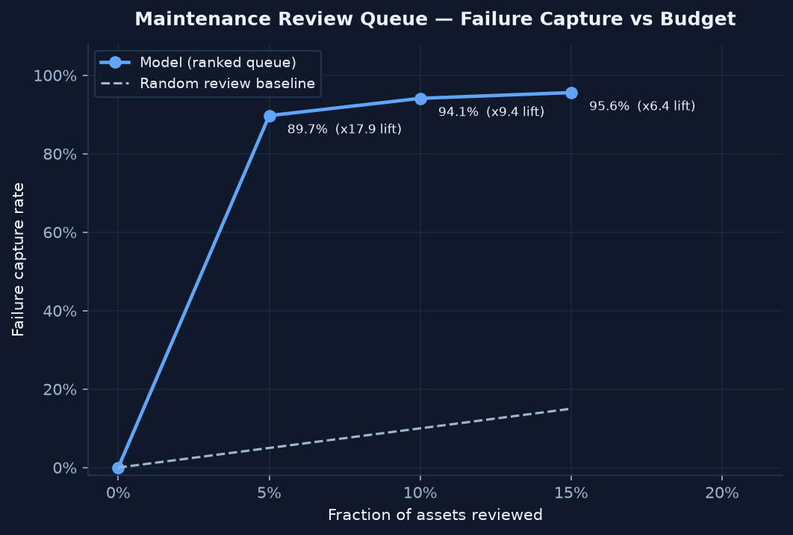

Reviewing the **top 10% of assets** (200 machines) captures **94.1% of all holdout failures**, 9.4x better than random review.

## Cost Impact

From [`cost-simulation.json`](docs/data/ai4i-case-study/cost-simulation.json), using illustrative cost assumptions:

| Scenario | Cost |
|----------|------|
| Reactive maintenance (no model) | $238,000 |
| Random review | $224,000 |
| Risk-ranked queue (top 10%) | $53,000 |
| **Savings vs reactive** | **$185,000 (77.7%)** |

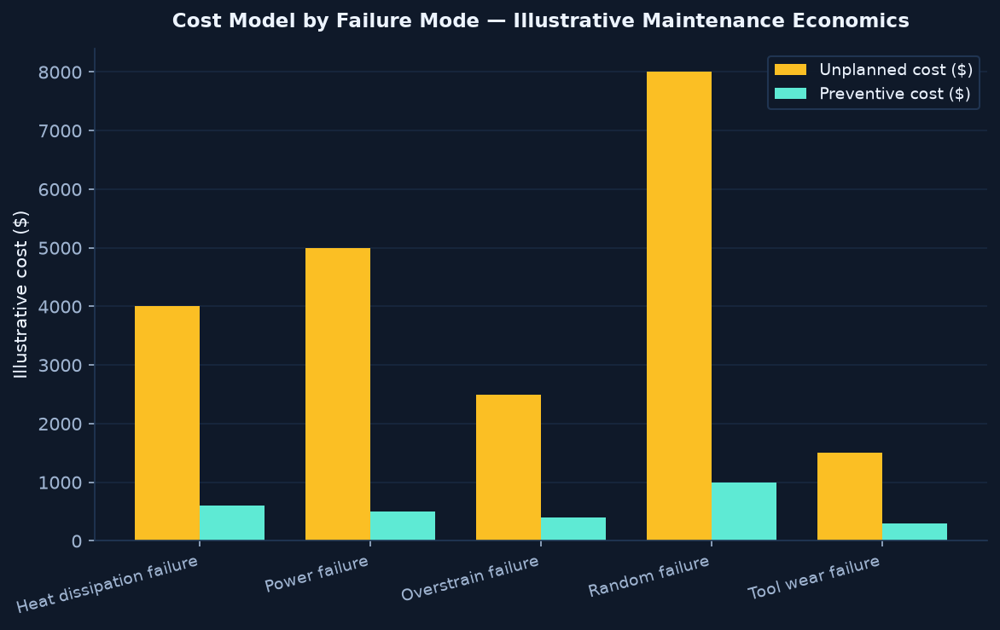

Per-failure-mode breakdown (differentiated unplanned vs. preventive cost): [`cost-model.json`](docs/data/ai4i-case-study/cost-model.json).

## RUL Regression (NASA C-MAPSS)

A separate case study. AI4I is a static snapshot dataset and cannot support remaining-useful-life regression; NASA's C-MAPSS turbofan dataset is run-to-failure, with multiple cycles per engine, which allows real RUL regression and a grouped train/validation split (`GroupKFold` by engine).

| Metric | Naive baseline (median RUL) | Tuned model |
|--------|------------------------------|-------------|
| RMSE (cycles) | 49.82 | **18.05** |
| PHM08 score | 166,570.5 | **837.6** |

**63.8% RMSE reduction** over the baseline on NASA's official FD001 test protocol; ~18 cycles RMSE is in line with published classical-ML results on this benchmark.

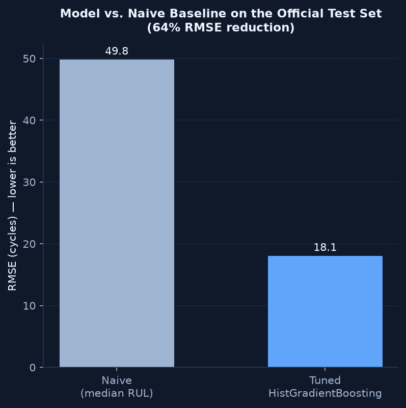
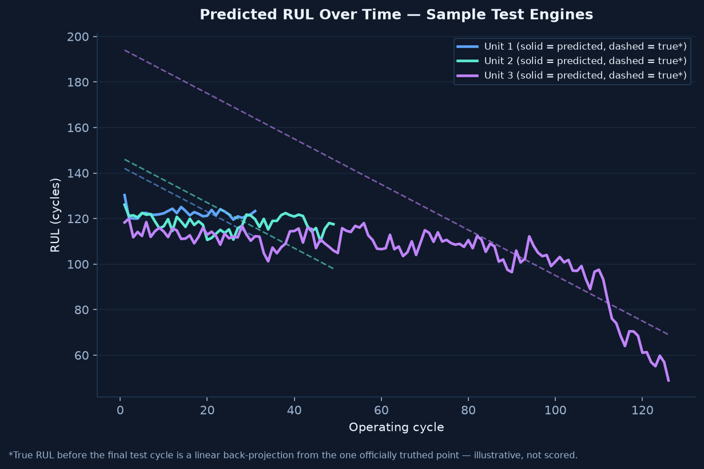

Methodology, features, evaluation and limitations: [`docs/rul-case-study.md`](docs/rul-case-study.md). The 48-input FD001 feature contract is in [`docs/RUL_INPUT_CONTRACT.md`](docs/RUL_INPUT_CONTRACT.md). Raw artifacts: [`docs/data/cmapss-rul-case-study/`](docs/data/cmapss-rul-case-study/).

## Engineering Decisions

- **Public benchmark data (AI4I 2020) instead of plant telemetry:** well documented, citable and reproducible.
- **PR-AUC as the primary metric:** with a 3.39% failure class, accuracy and even ROC-AUC look good on a model that never flags a failure. PR-AUC is used consistently for benchmarking, the hyperparameter search and robustness checks.
- **Gradient boosting instead of deep learning:** 10,000 tabular rows do not benefit from a neural network; a tree ensemble trains in seconds and `shap.TreeExplainer` gives fast, exact explanations for tree models.
- **Model files committed to git instead of a registry:** adequate for two models and one deployment target. Offline candidates are staged immutably with SHA-256 manifests and a manual promotion gate ([`OFFLINE_MODEL_REGISTRY.md`](docs/OFFLINE_MODEL_REGISTRY.md)); a larger system would use a registry such as MLflow.
- **Own Dockerfile and gunicorn:** the containerisation step is part of the project rather than hidden behind a buildpack.
- **Dashboard RUL stays a heuristic:** the dashboard simulates AI4I-schema machine-tool telemetry, while the RUL model is trained on turbofan time series. Connecting the two would mean inventing a mapping between unrelated sensor schemas, so they remain separate.
- **Same trained pipeline offline and live:** the dashboard loads the persisted `model.pkl` via joblib and scores simulated telemetry with it; there is no separate demo model.
- **Different validation per dataset:** repeated stratified holdouts for AI4I, `GroupKFold` by engine for C-MAPSS, chosen by what each dataset's structure supports.
- **Engineering hygiene:** pinned dependencies, structured logging, and a model card with training timestamp, library versions and dataset hash.

### Drift detection

[`analysis/check_drift.py`](analysis/check_drift.py) computes the **Population Stability Index (PSI)** between the AI4I training distribution and a synthetic batch in which `Tool wear [min]` is shifted by +80 minutes. The shifted feature and the derived `tool_wear_load_ratio` are flagged (PSI 2.79 and 2.21, well above the 0.2 threshold), while every unrelated feature stays under 0.03. Results appear in the `/case-study` "Drift Check" panel and in [`drift-report.json`](docs/data/ai4i-case-study/drift-report.json). Source-tagged offline telemetry comparisons are described in [`TELEMETRY_DRIFT_MONITOR.md`](docs/TELEMETRY_DRIFT_MONITOR.md).

### Production next steps

- Run the PSI check on a schedule against real incoming telemetry and alert when it crosses the threshold.
- Schedule the existing training pipelines (`analysis/run_ai4i_case_study.py`, `analysis/run_cmapss_rul_case_study.py`) via cron or Airflow, on a fixed cadence or a drift trigger, with a promotion step before swapping artifacts.
- Replace git-committed models with a registry that keeps prior versions retrievable for rollback.
- Monitor the live `RiskScore` distribution and compare predicted failure capture against real outcomes once ground truth exists.

## Stack

Python 3.11, Flask and gunicorn; Pandas, NumPy, SciPy and scikit-learn; SHAP (TreeExplainer); DuckDB (in-memory, reads JSON natively); Matplotlib; HTML/CSS/JavaScript frontend; Docker multi-stage build on Render; CI on CircleCI (`python-quality`, `browser-quality`, `container-quality`), with GitHub Actions workflows manual-only.

## Architecture

```
smart-factory-app/
├── main.py, decision_studio.py        # Dashboard, API and AI4I/RUL Decision Studio routes
├── case_study.py, rul_case_study.py   # Case-study pages
├── settings.py, layout.py             # Preferences + model card; shared accessible NEXUS navigation
├── analysis/
│   ├── run_ai4i_case_study.py         # AI4I ML pipeline (downloads UCI dataset on first run)
│   ├── run_cmapss_rul_case_study.py   # RUL regression pipeline (downloads NASA dataset on first run)
│   ├── generate_eda.py, generate_visuals.py, generate_cmapss_visuals.py   # Charts
│   ├── sql_queries.py                 # DuckDB SQL analysis on JSON artifacts
│   ├── check_drift.py                 # PSI drift check against a synthetic shifted batch
│   ├── _common.py                     # Shared helpers (to_float, write_json, model card)
│   └── artifacts/                     # model.pkl (AI4I classifier), rul_model.pkl (C-MAPSS regressor)
├── docs/                              # Case studies, contracts, chart assets, JSON results
├── static/                            # NEXUS CSS/JS + Decision Studio assets
├── tests/                             # unittest suites + Playwright E2E
├── .circleci/config.yml               # Python, browser and Docker quality jobs
├── Dockerfile, render.yaml            # Multi-stage image; Render Blueprint (Docker runtime)
└── requirements*.txt                  # runtime, dev (+ ruff, black, playwright), optional cloud
```

Offline data and model-governance modules in `analysis/`:

- `source_registry.py`: verified-source manifest with separate archive and model-card DataFrame SHA-256 semantics. `ai4i_batch.py`, `fd001_batch.py`: checksum-pinned input validation and local JSONL. `kaggle_parity.py`: row/label parity of a Kaggle AI4I mirror against UCI. `bigquery_plan.py`, `bigquery_load_guard.py`: 5-table/4-view SQL plan and file/schema preflight. `bigquery_cloud_read.py`: optional read-only BigQuery dry runs, real reads gated, no writes. `stage_benchmarks.py`: one-shot local staging. `benchmark_snapshot.py`: report behind `/api/benchmark-snapshot` ([#43](https://github.com/senanurcetin/smart-factory-app/pull/43)).
- `telemetry_monitor.py`: advisory PSI comparisons with source provenance ([#34](https://github.com/senanurcetin/smart-factory-app/pull/34)). `model_registry.py`: immutable SHA-256 model candidates and a manual promotion gate ([#38](https://github.com/senanurcetin/smart-factory-app/pull/38)). `rul_input_contract.py`: 48 ordered FD001 inputs from engine history ([#39](https://github.com/senanurcetin/smart-factory-app/pull/39)).

NEXUS identity, accessible navigation and the dark Decision Studio came in [#40](https://github.com/senanurcetin/smart-factory-app/pull/40).

## Local Setup

```bash
python -m venv .venv
# Windows: .venv\Scriptsctivate   macOS/Linux: source .venv/bin/activate
pip install -r requirements-dev.txt   # or requirements.txt without lint/format tooling

# Charts and SQL analysis from committed JSON artifacts (no dataset download)
python analysis/generate_eda.py
python analysis/generate_visuals.py
python analysis/sql_queries.py

# Optional retraining; trained copies of both models are committed.
python analysis/run_ai4i_case_study.py         # UCI download ~500 KB; writes analysis/artifacts/model.pkl
python analysis/run_cmapss_rul_case_study.py   # NASA download ~12 MB; writes analysis/artifacts/rul_model.pkl
python analysis/generate_cmapss_visuals.py

python main.py   # dashboard; loads model.pkl to score simulated telemetry
```

App: `http://127.0.0.1:8080` · AI4I case study: `/case-study` · RUL case study: `/rul-case-study` · Settings: `/settings`

### Offline BigQuery / Kaggle / NASA preparation

No cloud connector is needed to generate the SQL plan or validate data files:

```bash
python -m analysis.source_registry
python -m analysis.bigquery_plan --project YOUR_GCP_PROJECT --location EU
python -m unittest discover -s tests -p 'test_source_registry.py' -v
python -m unittest discover -s tests -p 'test_fd001_batch.py' -v
python -m unittest discover -s tests -p 'test_bigquery_plan.py' -v
```

Staging requires the SHA-256 values of your local raw files, the Kaggle handle/version/licence, and a BigQuery project, location, IAM scope and budget. Prepared CSV/FD001 JSONL files stay on local disk. The optional BigQuery client lives in `requirements-cloud.txt`; the dry-run adapter does not create datasets, load rows or execute cloud SQL by default. Full guide: [BigQuery & Kaggle Foundation](docs/BIGQUERY_KAGGLE_FOUNDATION.md).

## Docker

```bash
docker build -t smart-factory-app .
docker run -p 8080:8080 smart-factory-app
```

Multi-stage build served by `gunicorn` (2 workers). Both committed model files are baked into the image, so the container needs no dataset download or retraining. Release checks: [`docs/render-release-verification.md`](docs/render-release-verification.md).

## Tests

```bash
# All unittest suites: routes, artifacts, metric thresholds, chart presence,
# tuning/robustness/model-card contracts, dashboard <-> real model integration,
# drift checks, RUL contracts, settings page, negative paths for missing artifacts,
# source integrity, SQL planning, FD001/AI4I preparation, JSONL preflight,
# lineage, mocked BigQuery dry-run gates and offline Kaggle parity.
# test_e2e.py needs `playwright install chromium` once.
python -m unittest discover -s tests -v

# Lint and format
ruff check .
black --check .

# Syntax check (same as CI)
python -m compileall -q main.py case_study.py rul_case_study.py layout.py settings.py analysis tests
```

Backend tests use Flask's `test_client()` with the real offline model artifacts, and [`test_dashboard_reporting.py`](tests/test_dashboard_reporting.py) checks that CSV rows match API-scored values. [`test_e2e.py`](tests/test_e2e.py) drives headless Chromium through desktop, 1024px tablet and 375px mobile layouts, checking console errors, chart rendering, keyboard navigation, overflow and that the mobile nav collapses. With `E2E_SCREENSHOT_DIR=artifacts/gallery` it writes `smart-factory-desktop-1440.png`, `smart-factory-mobile-375.png` and, if the outage scenario is reached, `smart-factory-telemetry-outage.png`.

CI runs on [CircleCI](https://app.circleci.com/pipelines/github/senanurcetin/smart-factory-app) ([config](.circleci/config.yml)): `python-quality` (lint, format, compile, committed-artifact verification, unit suites), `browser-quality` (Chromium E2E) and `container-quality` (Docker build and runtime smoke test). CI validates the committed model artifacts and does not download UCI/NASA data, access Kaggle or run BigQuery jobs. [Commit history and status on `main`](https://github.com/senanurcetin/smart-factory-app/commits/main/).

## Documentation

| Document | Contents |
|----------|----------|
| [`docs/case-study.md`](docs/case-study.md) | AI4I methodology, results, limitations |
| [`docs/rul-case-study.md`](docs/rul-case-study.md) | C-MAPSS RUL methodology, results, limitations |
| [`docs/data-quality-guide.md`](docs/data-quality-guide.md) | Data-quality methodology |
| [`docs/TELEMETRY_INPUT_CONTRACT.md`](docs/TELEMETRY_INPUT_CONTRACT.md) | Telemetry input contract |
| [`docs/RUL_INPUT_CONTRACT.md`](docs/RUL_INPUT_CONTRACT.md) | FD001 RUL input contract |
| [`docs/render-release-verification.md`](docs/render-release-verification.md) | Render release checklist |
| [SEO and social preview guide](docs/SEO_AND_SOCIAL_PREVIEW_GUIDE.md) | Canonical URLs, screenshot sources, social preview assets |
| [`docs/data/ai4i-case-study/summary.json`](docs/data/ai4i-case-study/summary.json) | Final model metrics and confusion matrix |
| [`docs/data/cmapss-rul-case-study/summary.json`](docs/data/cmapss-rul-case-study/summary.json) | RUL RMSE, PHM08 score, baseline comparison |

## Limitations

- **Scope.** This is a research and demonstration project, not a deployed factory control or predictive-maintenance service. PLC/factory telemetry ingest is not enabled; the MQTT/OPC UA modules are offline validation code only.
- **Data.** AI4I 2020 is a synthetic dataset, so the metrics are benchmark results rather than plant-specific claims. Two public AI4I CSV mirrors share SHA-256 `59db4f1d9c34c58136d89e5a006ec190dcea19e9dbea74f6b3b0c6f22a44d183`, but that is not an official UCI checksum.
- **Simulated dashboard.** Sensor, OEE and line data on the dashboard are simulated; the risk score comes from the real trained model but is not a calibrated failure probability. The dashboard RUL is a heuristic derived from the risk score, not the C-MAPSS regression model.
- **Calibration.** ECE and Brier score are descriptive on a single 2,000-row holdout and do not establish prospective calibration on real machines. The model was trained with scikit-learn 1.9.0 and the audit reloaded it under 1.8.0 with compatibility warnings; matching results there do not guarantee pickle compatibility in general.
- **Holdout reuse.** Model selection and tuning both used the seed-42 holdout. The other four splits are sensitivity checks on the same 10,000 rows, not an untouched external test, so some selection bias remains.
- **Validation design.** AI4I has no time axis or asset grouping, so stability is checked with repeated holdouts rather than time-aware or grouped CV.
- **Random failures.** RNF capture is 25% at the top-10% budget.
- **Cost model.** Cost figures are illustrative; real maintenance economics vary by plant and equipment.
- **SHAP.** Attributions use an interventional TreeExplainer with a 200-row background sample, an approximation of full-dataset Shapley values.
- **BigQuery and Kaggle.** The integration is offline code, a SQL plan, data contracts and mocked provider tests. Kaggle source versions, official raw-file checksums, BigQuery IAM/billing and a real upload have not been verified. The adapter supports read-only dry runs and opt-in bounded SELECT; it performs no writes and does not enforce a global spending cap. `/api/benchmark-snapshot` serves committed offline results, not a live BigQuery, Kaggle or plant feed.
- **Screenshots.** The images in this README were captured from Render on 14 October 2026 ([provenance](docs/assets/production_screenshot_provenance_20261014.json)) and predate later UI changes, including the NEXUS identity in PR #40.
- **Release status.** CI results and screenshots apply only to the revision they ran on. Check the commit's CircleCI status and the deployed Render SHA before treating a revision as released.

## License

MIT
